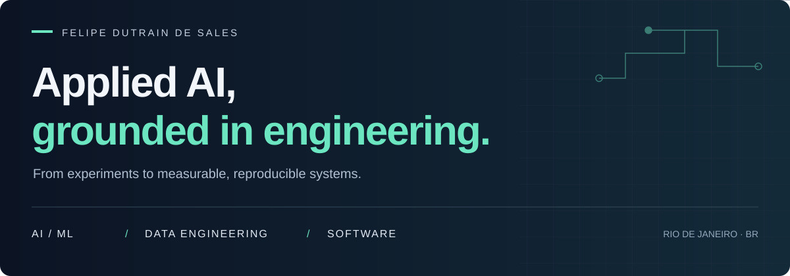

<!-- FelipeSales18 | GitHub profile -->

  

  <b>Computer Engineering @ IBMEC</b> &nbsp; / &nbsp; Rio de Janeiro, Brazil 
  Building, measuring, and refining AI systems — from constrained hardware to the cloud.

  <a href="https://www.linkedin.com/in/felipe-dutrain-756135342/">LinkedIn ↗</a> &nbsp; · &nbsp;
  <a href="https://huggingface.co/felipedutrain">Hugging Face ↗</a> &nbsp; · &nbsp;
  <a href="mailto:felipedutrain@gmail.com">Get in touch ↗</a>

---

### 01 / About

I'm Felipe, a Computer Engineering student working with emerging technologies. I build projects across **language models, computer vision, data engineering, and automation**.

What interests me most is the engineering around the model: making it run within real constraints, designing useful evaluations, and understanding where it fails.

**Currently exploring** &nbsp; `Efficient LLM inference` &nbsp; `Applied ML` &nbsp; `Reliable data systems`

## 02 / Selected work

### LLM-PS4
#### A modern language model. A 2013 game console.

Fine-tuned **Qwen3-1.7B with GRPO + LoRA**, converted it to GGUF, and ran it on an original PlayStation 4 using Linux and `llama.cpp`, with GPU acceleration through Vulkan.

| 1.56× faster answers | 72.9% flexible accuracy | 1,319 questions |
| :--- | :--- | :--- |
| PS4 GPU vs. CPU · same 100 questions | Q4_K_M · PS4 GPU | Complete GSM8K test set |

The work goes beyond getting a model to run: paired evaluations, quantization trade-offs, per-question results, and reproducible experiment manifests. The full-precision tuned model achieved **75.8% strict-format accuracy** and **76.3% flexible accuracy**.

What the results do — and don't — show

The 1.56× speedup refers to average time per answer on 100 paired questions. The 72.9% result comes from the full 1,319-question evaluation. Fine-tuning improved format compliance; it did not establish an improvement in flexible answer accuracy. This is a single training run, and the test set was reused across project decisions.

`PyTorch` `GRPO / LoRA` `GGUF` `llama.cpp` `Vulkan` `Linux`

**[Code & benchmarks ↗](https://github.com/FelipeSales18/llm-ps4)** &nbsp; / &nbsp; [Model & weights ↗](https://huggingface.co/felipedutrain/qwen3-1.7b-gsm8k-grpo)

---

### AI Financial Data Assistant
#### Natural-language questions. Controlled SQL. Measured results.

A hybrid analytics assistant: an LLM classifies intent, deterministic code compiles **read-only SQL**, and Amazon Athena queries partitioned Parquet on S3. Validation includes typed plans, SQL AST checks, and prompt-injection checks.

| 81.7% holdout accuracy | 59 / 59 pruning cases |
| :--- | :--- |
| 49 of 60 previously unseen questions · Hybrid v3.1 | Applicable cases in the same evaluation |

Built with **synthetic financial data**. The reference implementation is Hybrid v4; the holdout result above belongs to v3.1. Known regressions are documented separately from unseen evaluations.

`Python` `AWS S3 / Athena / Glue` `NVIDIA NIM` `SQLGlot` `Parquet`

**[Architecture, code & evaluations ↗](https://github.com/FelipeSales18/ai-financial-data-assistant)**

---

### Police Argos
#### From vehicle images to readable plates.

A local computer-vision pipeline for Brazilian license plates, supporting old-format and Mercosul plates. Combines **YOLOv11 detection** with **EasyOCR**, multi-scale processing, OCR voting, and confidence visualizations.

`YOLOv11` `EasyOCR` `OpenCV` `Python`

**[Explore the project ↗](https://github.com/FelipeSales18/police-argos)** &nbsp; / &nbsp; [Detection model ↗](https://huggingface.co/felipedutrain/placa-br-yolov11)

## 03 / Technical toolkit

| Focus | Tools I work with |
| :--- | :--- |
| **AI & ML** | Python · PyTorch · Hugging Face · scikit-learn · YOLO · OpenCV |
| **Data & cloud** | SQL · PostgreSQL · Pandas · Parquet · AWS S3 / Athena / Glue |
| **Backend & automation** | Django / DRF · REST APIs · n8n · Supabase · Docker |
| **Software & systems** | JavaScript / TypeScript · React · Linux · Git · llama.cpp · Vulkan |

## 04 / Let's connect

I'm interested in **AI/ML engineering, data engineering, and software development** — especially opportunities to learn from experienced engineers and contribute to useful systems.

**[Start a conversation ↗](mailto:felipedutrain@gmail.com)** &nbsp; / &nbsp; [LinkedIn](https://www.linkedin.com/in/felipe-dutrain-756135342/) &nbsp; / &nbsp; [Hugging Face](https://huggingface.co/felipedutrain)
